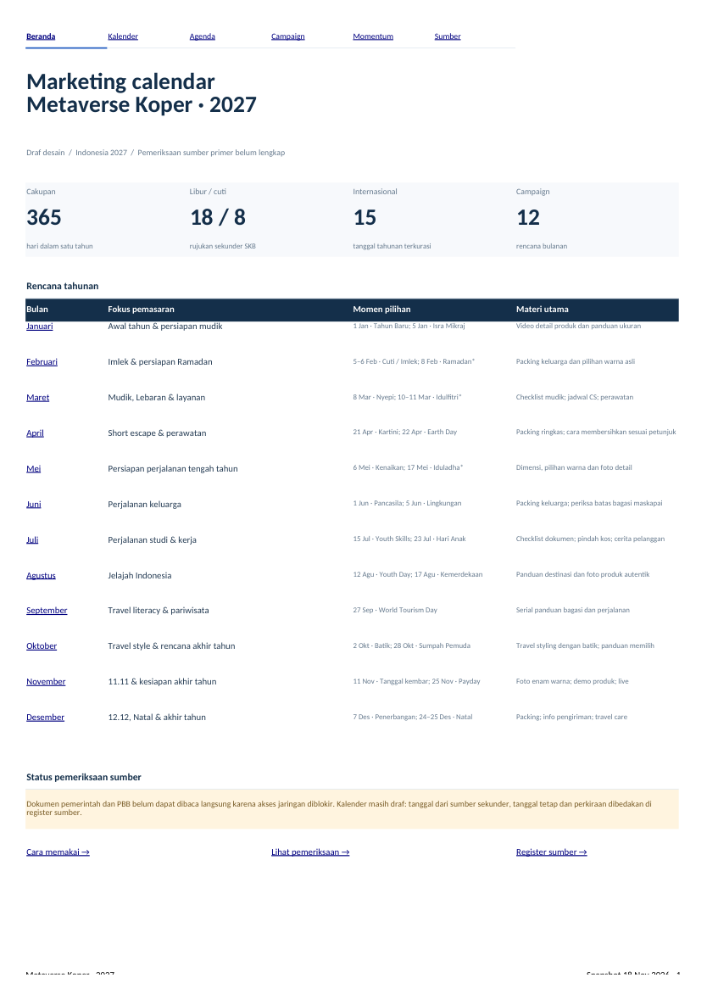
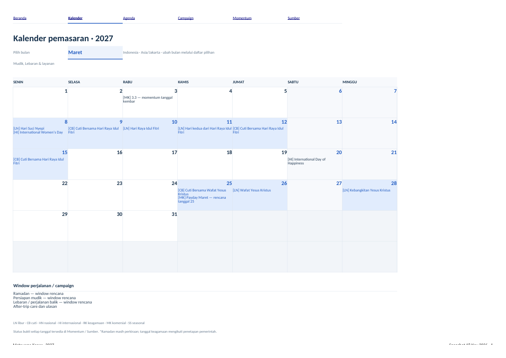

# Pratinjau desain kalender 2027 — DRAF

[Download Excel v2 — DRAF](./Metaverse_Koper_Marketing_Calendar_2027_v2_DRAFT.xlsx?raw=true)

Desain lebih ringkas dengan 8 tab kerja: Beranda, Kalender, Agenda, Campaign, Momentum, README, Sumber dan Validasi. Satu tab pengaturan disembunyikan.

- Pilihan bulan pada Kalender!B4.
- Nama bulan di Beranda membuka tanggal awal bulan pada Agenda.
- Perubahan momentum memperbarui teks agenda dan kalender setelah kalkulasi ulang.
- Kolom input tim menggunakan biru muda; status dan kanal memiliki pilihan dropdown.
- Anggaran dan target aktual tidak diasumsikan.

**Status data:** ini pratinjau desain, bukan kalender yang telah diverifikasi primer penuh. Data tanggal masih memakai draf sebelumnya dengan status sumber yang eksplisit. Sumber pemerintah dan PBB belum dapat dibaca langsung karena jaringan menolak koneksi (CONNECT 403). Tidak ada klaim bahwa 97 agenda telah diperiksa ke dokumen primer. Pengguna meminta agar dokumen tepercaya dibaca sebelum data final; langkah tersebut masih menunggu akses sumber.

Excel 2019 / Microsoft 365, LibreOffice modern, atau Google Sheets dengan TEXTJOIN diperlukan untuk kalender interaktif. Data tidak tersinkron ke situs sumber. Jika menambah event di luar 97 baris, rentang rumus perlu diperluas.

Pengujian: kalkulasi ulang Januari, Februari, Maret dan Desember, posisi tanggal / hari, window seasonal, serta propagasi perubahan satu nama event ke agenda dan kalender telah lolos. Tidak ada kesalahan rumus pada fixture yang diperiksa.

## Beranda

## Kalender

